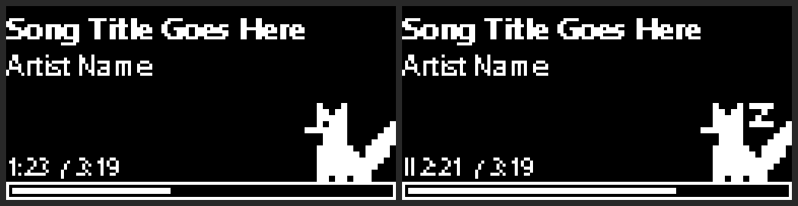

# Arctis Nova Pro OLED: Now Playing

Shows the song you're listening to on the OLED screen of a SteelSeries GameDAC / base station, with a progress bar and a little animated pixel fox.



*Preview of the 128×64 screen, scaled up 4×. Left: playing. Right: paused.*

- Title and artist, with long names scrolling
- Elapsed / total time and a progress bar
- The fox swishes its tail while music plays and falls asleep when you pause
- Comes back right after the volume / ChatMix overlay disappears
- Runs hidden in the background and can start with Windows

It reads whatever Windows shows in its media controls, so it works with YouTube Music in a browser and also with Spotify, other browsers, and most media players.

## Requirements

- Windows 10 or 11
- [SteelSeries GG](https://steelseries.com/gg) running
- A SteelSeries device with an OLED screen. It was built and tested on the **Arctis Nova Pro** GameDAC; other OLED devices may work.

Nothing else to install. It uses only PowerShell and Windows APIs that come with Windows.

## Install

1. Download this repository (**Code → Download ZIP**) and extract it somewhere permanent, for example `C:\Tools\arctis-nova-pro-oled`.
2. In that folder, right-click `install.ps1` and choose **Run with PowerShell**, or run:
   ```powershell
   powershell -ExecutionPolicy Bypass -File .\install.ps1
   ```

This starts it immediately and adds a shortcut to your Windows Startup folder. Don't move the folder afterwards; if you do, run `install.ps1` again.

## Usage

| What | How |
|---|---|
| Try it in a visible window (shows "Now playing" and any warnings) | `powershell -ExecutionPolicy Bypass -File .\ytm-oled.ps1` |
| Stop it | `powershell -ExecutionPolicy Bypass -File .\stop.ps1` |
| Remove from startup | `powershell -ExecutionPolicy Bypass -File .\uninstall.ps1` |

## Troubleshooting

- **Nothing on the screen:** Make sure SteelSeries GG is running, then run `ytm-oled.ps1` in a window. If it prints "Now playing: …", the track is being read and the problem is on the GG side. Check that the OLED isn't inside one of its menus.
- **"Now playing" never appears:** Check that your player shows up in the Windows media flyout (press a media key or open the volume panel). Some browsers have a setting for media controls.
- **It shows the wrong app:** The script uses the first media session that is playing.

## How it works

`ytm-oled.ps1` reads the current track from the Windows media session API, draws a 1-bit image with System.Drawing (text, progress bar and the fox sprite), and sends it four times a second to SteelSeries GG's local [GameSense API](https://github.com/SteelSeries/gamesense-sdk). It renders every OLED size GameSense supports (128×36 up to 128×64), so GG can pick the one that matches the device.

## License

MIT
